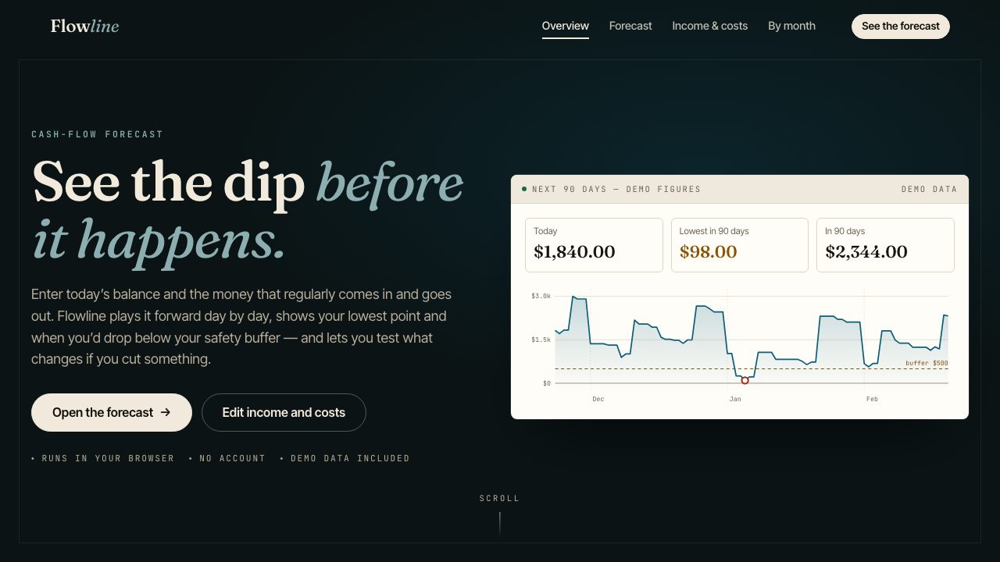
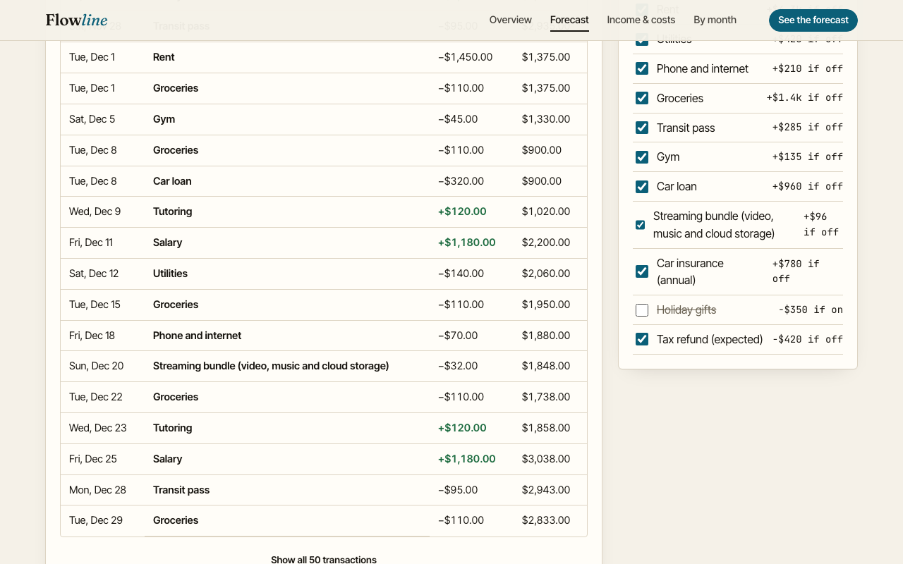
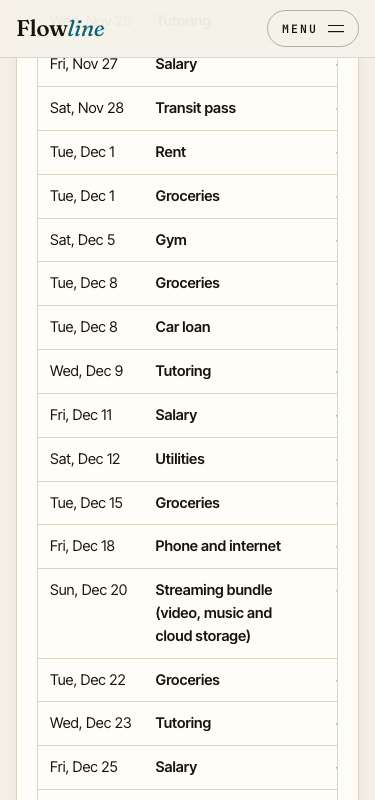

# Flowline

A cash-flow forecast: start from today’s balance, add income and costs with their real schedules, and see the projected balance day by day — the lowest point, days under your safety buffer, a ledger with running balance, and what changes if you switch something off. Not financial advice.

**Live demo:** [https://flowline.vercel.app/](https://flowline.vercel.app/) — runs entirely in your browser; demo data is fictional and labelled.



| Forecast | Mobile |
| --- | --- |
|  |  |

## Run it

```bash
npm install
npm run dev        # http://localhost:5211
npm test
npm run build
npm run test:e2e   # Playwright smoke test (npm run e2e:install once if Chromium is missing)
```

## Main workflow

1. The app opens with labelled, fictional **demo figures**: fortnightly pay, side income, rent, bills, weekly groceries, a car loan, two one-off costs and an expected refund. The forecast dips below the $500 buffer around the new year. **Income & costs → Clear demo items** removes them.
2. **Forecast** → set the balance, its date, a safety buffer and how far ahead to look (30–365 days). KPIs show the lowest point, days under the buffer, money in/out and the end balance, with a warning if you’d go overdrawn.
3. The **chart** marks months, the buffer, zero and the lowest point. Hover, or focus it and use ←/→ (Shift for a week, Home/End), to read any day and its transactions.
4. **What if…** → switch items off and on; each shows how much it changes the end balance. Nothing is deleted.
5. **Income & costs** → add items (once, every N weeks, monthly on a day with month-end handling, yearly) and see each one’s average monthly effect. **By month** → in/out chart and a sortable month table with month-end balances. Export the ledger as CSV.

## Rules

- The balance is taken as the start of the “as of” day, so items due that day are applied.
- Monthly day 29–31 falls on the last day of shorter months; yearly 29 February falls on 28 February outside leap years.
- Average monthly effect: weekly × 52 ÷ 12 ÷ N, monthly × 1, yearly ÷ 12; one-off items are excluded.
- A stale “as of” date is flagged with a one-click fix.

## Design

Shared editorial system: Fraunces display type, Inter Tight interface text, mono axes and amounts, an ink hero whose preview is the real chart, and a warm paper workspace. The line draws itself on load; animation is disabled under `prefers-reduced-motion`.

## Tests

- `src/lib/forecast.test.ts` — once/weekly/month-end/leap-day schedules, labels and monthly averages, day-by-day projection, lowest point and buffer stats, monthly summary, switching impact, validation.
- `src/App.test.tsx` — KPIs and chart, keyboard reading of the chart, overdraft warning and balance validation, what-if switch, adding a fortnightly item.
- `e2e/smoke.spec.ts` — landing, hover readout, what-if with reload persistence, add an item, monthly view, plus 375px layout checks.

## Limitations

- Manual figures only; no bank connection, interest or variable amounts.
- One currency (US dollar formatting).
- A projection, not a prediction — anything you leave out isn’t in it.

## Future improvements

- Ranges for variable costs (best/worst case bands); multiple accounts.

## Licence

MIT — see [LICENSE](LICENSE).
